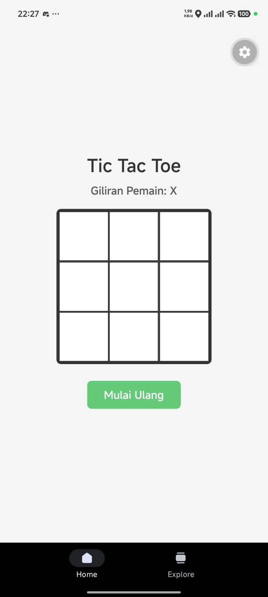
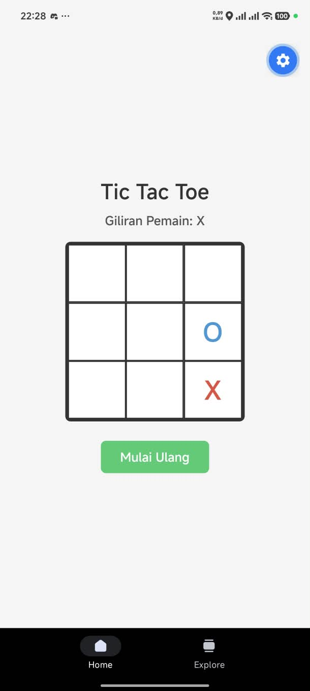
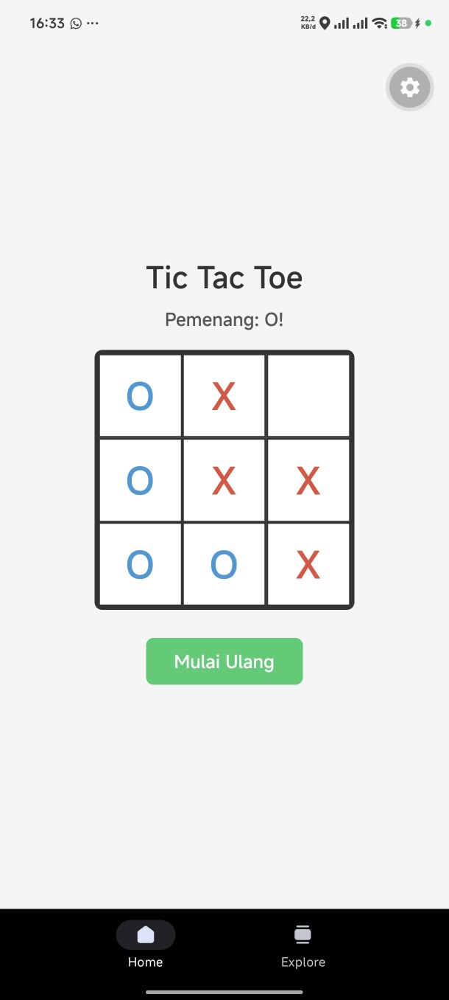

# Tic Tac Toe

Nama: [Jaffna Naufal Safaraz]
NIM: [41155050240003]
Mata kuliah: Pemrograman Mobile (Tugas Sesi #5)
Program studi: Teknik Informatika, Universitas Langlangbuana

## Deskripsi

Tic Tac Toe merupakan permainan tradisional untuk dua orang yang dimainkan di atas papan berukuran 3x3. Para pemain secara bergantian mengisi kotak yang masih kosong dengan simbol X atau O. Siapa pun yang berhasil menyejajarkan tiga simbol yang sama dalam satu baris, kolom, atau diagonal akan dinyatakan menang. Apabila seluruh kotak telah terisi dan tidak ada satu pun garis yang terbentuk, hasilnya adalah seri. Aplikasi ini dikembangkan menggunakan React Native dan Expo sebagai bahan latihan pembuatan aplikasi mobile dalam mata kuliah Pemrograman Mobile.

## Fitur

- Papan permainan 3x3 yang dapat ditekan.
- Dua pemain bermain bergantian dengan simbol X dan O.
- Deteksi pemenang secara otomatis.
- Deteksi hasil seri ketika semua kotak terisi tanpa pemenang.
- Tombol untuk mengulang permainan dari awal.

## Teknologi

- React Native
- Expo (dengan Expo Router untuk navigasi berbasis file)
- TypeScript

## Cara Menjalankan

1. Pastikan Node.js sudah terpasang.
2. Buka folder proyek di terminal, lalu install library:
   ```bash
   npm install
   ```
3. Jalankan aplikasi di browser:
   ```bash
   npx expo start --web
   ```
   Atau jalankan dengan `npx expo start` lalu buka lewat Expo Go di HP.

## Cara Kerja

1. **Papan permainan.** Papan 3x3 disimpan sebagai daftar berisi 9 kotak. Setiap kotak berisi `X`, `O`, atau kosong.
2. **Giliran pemain.** Aplikasi mencatat giliran saat ini. Setiap kali pemain menekan kotak yang masih kosong, simbol pemain tersebut diisikan, lalu giliran berpindah ke pemain lain.
3. **Menentukan pemenang.** Setelah setiap langkah, aplikasi memeriksa delapan kemungkinan garis kemenangan: tiga baris, tiga kolom, dan dua diagonal. Jika ketiga kotak pada salah satu garis berisi simbol yang sama, pemain dengan simbol itu dinyatakan menang.
4. **Hasil seri.** Jika semua kotak sudah terisi dan tidak ada garis kemenangan, permainan dinyatakan seri.
5. **Mengulang permainan.** Tombol ulang mengosongkan semua kotak dan mengembalikan giliran ke pemain pertama.

## Struktur File

- `src/app`: halaman dan logika utama aplikasi.
- `assets`: gambar dan ikon aplikasi.
- `app.json`: konfigurasi aplikasi Expo.
- `package.json`: daftar library yang digunakan.

## Screenshot

### Tampilan awal



### Saat bermain



### Hasil permainan


